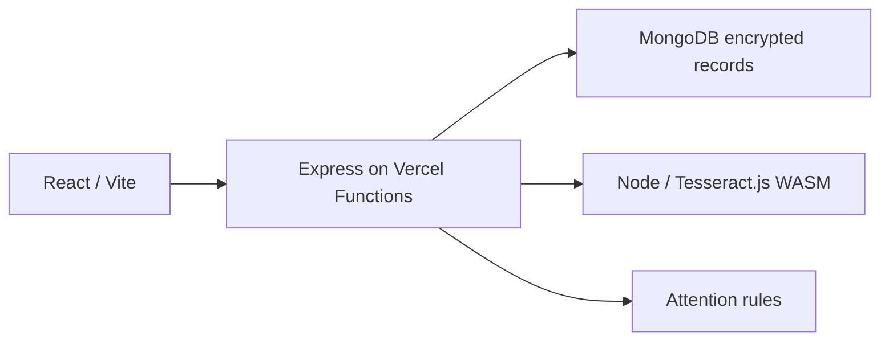

# Architecture

## Vercel runtime

The default Vercel deployment serves the frontend and API from one origin. `api/index.mjs` delegates startup to `server/vercel.mjs`, which validates the private database/key settings and initializes the API with MongoDB, database-backed mutation coordination and in-process OCR/scoring. It requires a stable private encryption key; a function's temporary filesystem is not used for persistent records. Function duration is capped at 60 seconds and uploads at 4 MB.

The Node OCR adapter bundles English trained data and runs Tesseract.js/WASM. It does not invoke native Python or send images to an OCR provider. Attention scoring uses the same explicit rules as the local Python service. Reminders are evaluated on requests instead of relying on a serverless background interval.

## Components

| Component | Responsibility |
| --- | --- |
| `src/` | TypeScript UI, charts, forms and same-origin API requests. Vite proxies `/api` locally. |
| `api/index.mjs`, `server/vercel.mjs`, `vercel.json` | Vercel function startup, required configuration and static/API routing. |
| `server/` | Authentication, household access, prescriptions, schedules, records, notification evaluation and audit history. |
| `server/intelligence-node.mjs` | Vercel OCR, prescription parsing and rules-based attention scoring. |
| `services/intelligence/` | Python/FastAPI OCR and scoring for local and Docker deployments. |
| `scripts/dev.mjs` | Local service startup, health checks and shutdown. |
| `scripts/setup.sh` | Node dependencies, Python environment and frontend build. |

Local development uses Express, FastAPI/native Tesseract and SQLite unless MongoDB is configured. Docker retains separate API/Python services; the optional Render profile supervises both in one container. These modes use a running reminder worker, while Vercel evaluates reminders when requests arrive.

## Storage and access

Each account belongs to one household. Caregivers manage the plan, patients record doses/symptoms, and clinicians review records and resolve follow-ups. Invitations assign membership and role. The API checks sharing consent.

SQLite and MongoDB use AES-256-GCM encrypted record payloads. Identifiers, kinds and household indexes remain unencrypted metadata. MongoDB is required on Vercel for persistence and coordination across function instances. Local SQLite requires one API process.

## Scheduling and review

Courses use explicit local times, start date, duration and an IANA timezone. Dose IDs derive from medication ID and scheduled timestamp. Updates remove future unrecorded doses while retaining past reports. Nonexistent daylight-saving times are rejected.

OCR fields remain editable drafts until all required values are reviewed and confirmed. Images are not retained after extraction; draft text is removed after confirmation. Prescription history stores uploaded records and version metadata without automatic reconciliation.

## Scoring

Attention rules expose the recorded inputs behind each score. Insufficient history returns an unavailable result. The weights are documented in the [intelligence service](../services/intelligence/README.md) and have not been clinically validated. Scoring receives dose timestamps/statuses and pain/mobility reports without patient names or free-text notes.

Trained risk models, a medication lexicon, hospital-wide membership and external outreach require separate implementation and validation. Local Python also offers an optional TrOCR adapter with a verified local model; Vercel uses bundled English Tesseract.js.
