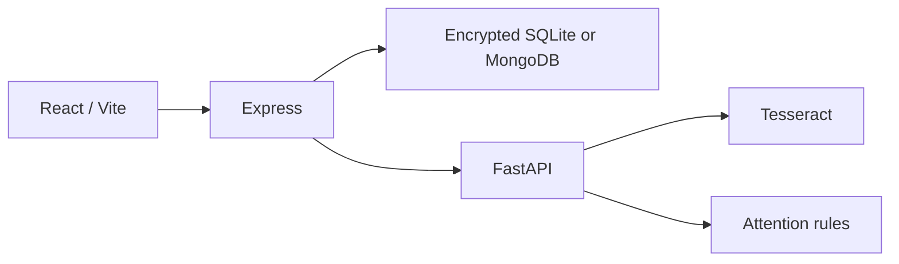

# Architecture

| Component | Responsibility |
| --- | --- |
| `src/` | TypeScript UI, charts, forms and same-origin API requests. Vite proxies `/api` in development. |
| `server/` | Authentication, household access, prescriptions, schedules, dose records, reminders and audit history. |
| `services/intelligence/` | Local OCR and rules-based scoring. Scoring receives timestamps, statuses and symptom reports, without patient identity or notes. |
| `scripts/dev.mjs` | Service startup, health checks and shutdown. |
| `scripts/setup.sh` | Node dependencies, Python virtual environment and frontend build. Caches are stored in ignored `.cache/`. |

## Storage and access

Each account belongs to one household. Caregivers manage the plan, patients record doses/symptoms, and clinicians review records and resolve follow-ups. Invitations assign household membership and role. Sharing consent is checked by the API.

SQLite and MongoDB use the same AES-256-GCM encrypted record format. Record identifiers, kinds and household indexes remain unencrypted metadata. The current mutation locks require one API process.

## Scheduling

Medication courses use explicit local times, start date, duration and an IANA timezone. Dose IDs derive from medication ID and scheduled timestamp. Updates remove future unrecorded doses while retaining past reports. Nonexistent daylight-saving times are rejected.

OCR produces editable drafts. All fields must be reviewed before activation. Images are discarded after extraction; draft text is removed after confirmation. Prescription history stores uploaded records and version metadata, without automatic reconciliation.

## Scoring

The first version uses explicit attention rules so that each score can be traced to its inputs. Insufficient history produces an unavailable result. The weights are documented in the [intelligence service](../services/intelligence/README.md) and have not been clinically validated.

Tesseract is the default OCR engine. The optional TrOCR adapter requires a verified local model. Trained risk models, a medication lexicon, hospital-wide membership and external outreach require separate implementation and validation.
